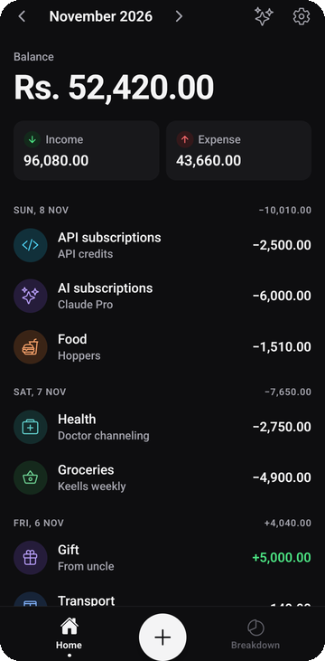
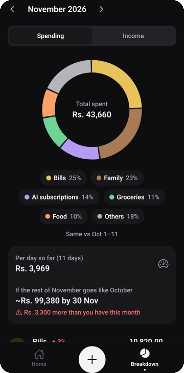
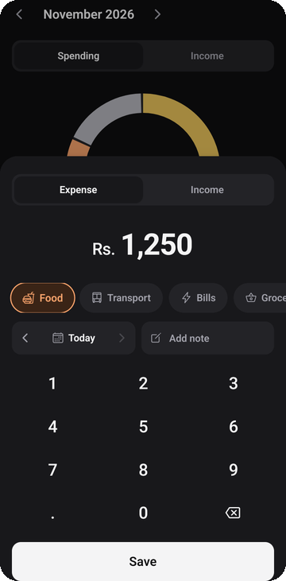
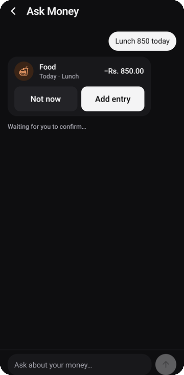

<p align="center">
  
</p>

<h1 align="center">Money</h1>

<p align="center">
  A calm, private money tracker for Android.<br />
  Add an entry in under 5 seconds, see where your money goes, and ask questions about it in plain words.
</p>

<p align="center">
  
  
  
  
  
</p>

<p align="center">
  
  &nbsp;
  
  &nbsp;
  
</p>

## Features

- **Fast entry.** A number pad, one tap for the category (your last one is picked for you), today's date by default, an optional note. Swipe a row to delete, with Undo.
- **Month view.** Balance, income and expense at the top, entries grouped by day. Last month's leftover carries into the new month automatically.
- **Breakdown.** A donut of where the money went, change against last month, spending per day, and an estimate for the end of the month. Tap a category to see its entries.
- **Ask Money (optional).** Chat with Claude about your entries in English, Sinhala or Singlish. It can also add entries and create new categories, and nothing is saved until you confirm.
- **Private by design.** No account, no server. The database is encrypted on the phone (SQLCipher, AES-256), app lock uses your fingerprint or screen lock, and backups are a JSON file you export yourself.
- **Light and dark themes**, haptics and small animations that explain what changed.

## Ask Money

<p align="center">
  
  &nbsp;
  
  &nbsp;
  
</p>

Turn it on in **Settings → Assistant** and paste your own [Anthropic API key](https://console.anthropic.com).

- The key is stored in the Android Keystore through `expo-secure-store`. It is not in the code, the APK or backups.
- Answers come with cards drawn from the phone's own data (month totals, category bars, matching entries), so the numbers are always right. Claude's text explains them: a one-line answer and a few bullets, with amounts in bold and + / − in green / red.
- Claude reads your data only through a few tools that run on the phone: month summary, category breakdown, entry search and the category list. It gets only what the question needs.
- Writing works through `add_entry` and `add_category`. Both show a card, and nothing is saved until you tap it.
- Haiku 5.5 is the default (cheap), and you can switch to Opus 5.5. Chat history stays in memory and is gone when you leave the screen.
- Tip: set a monthly spend limit in the Anthropic Console.

## Security

| What | How |
| --- | --- |
| Data on the phone | SQLCipher (AES-256) with a random 256-bit key in the Android Keystore. An older plain database is migrated, checked, and then deleted. |
| Opening the app | Optional app lock with strong biometrics or the screen lock. Screenshots are blocked while it is on, and moving the clock back doesn't skip the lock. |
| Backups | Android Auto Backup is off. Export and import a JSON file yourself (import is validated and size-limited). |
| Permissions | Biometrics, vibration (haptics) and internet (Ask Money). Storage, media, overlay and microphone permissions are blocked. |
| Network | None, unless you use Ask Money. It talks only to `api.anthropic.com`. |

Expo Go has no SQLCipher, so during development the database is not encrypted. Settings shows which is the case.

## Stack

| Concern | Choice |
| --- | --- |
| Framework | React Native 0.88 with **Expo SDK 58**, **Expo Router** (file-based) |
| Language | **TypeScript** (strict) |
| Database | **expo-sqlite** with SQLCipher, typed repositories, SQL migrations, a small shared query cache |
| State | **Zustand** for small UI state only |
| Animation | **Reanimated 4** and **Gesture Handler** |
| Charts | **react-native-svg** (donut) |
| Validation | **Zod** |
| AI | **@anthropic-ai/sdk** (streaming, tool use) through `expo/fetch` |
| Testing | Jest (`jest-expo`) |

Money is stored as integer minor units and dates as `YYYY-MM-DD` strings. See [docs/DATA_MODEL.md](docs/DATA_MODEL.md).

## Getting started

```bash
npm install
npx expo start          # scan the QR code with Expo Go
```

On a phone connected over USB (no Wi-Fi needed):

```bash
npx expo start --localhost --port 8082
adb reverse tcp:8082 tcp:8082
adb shell am start -a android.intent.action.VIEW -d "exp://127.0.0.1:8082" host.exp.exponent
```

Build an installable APK with encryption turned on (Expo Go can't do this):

```bash
npx eas-cli build -p android --profile preview
```

Checks before a commit:

```bash
npm run typecheck
npx eslint .
npm test
```

## Docs

| Doc | What it covers |
| --- | --- |
| [docs/PRODUCT.md](docs/PRODUCT.md) | What we build, scope, and what we don't build yet |
| [docs/ARCHITECTURE.md](docs/ARCHITECTURE.md) | Layers, folders, data flow, key decisions |
| [docs/DATA_MODEL.md](docs/DATA_MODEL.md) | Storage, tables, money and dates, queries |
| [docs/DESIGN.md](docs/DESIGN.md) | Visual language, design tokens, screens |
| [docs/MOTION.md](docs/MOTION.md) | Animation principles and the exact animations |
| [docs/CONVENTIONS.md](docs/CONVENTIONS.md) | Code style, naming, testing, git |
| [docs/ROADMAP.md](docs/ROADMAP.md) | Milestones and future ideas |

The app icon and splash images are generated by [scripts/make-icon.py](scripts/make-icon.py).
